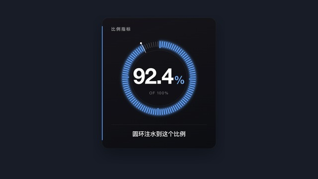
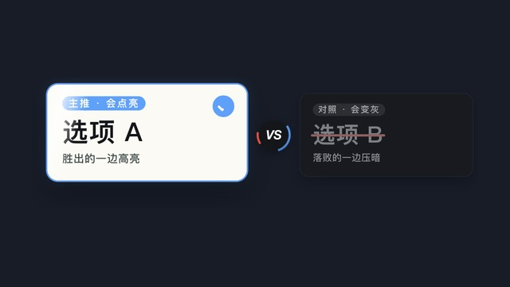
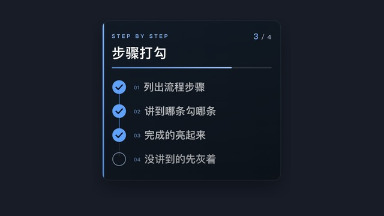

# Effect library thumbnail examples

Three candidate static thumbnails for [issue #7](https://github.com/jeszhou/overlay-studio/issues/7). They are examples for discussion, not a proposed UI implementation.

Each image comes from the application's export view with the card's default parameters, captured at **2.0 s**. The alpha bounds are cropped with a small threshold, then fitted without stretching into a 640 × 360 dark canvas. The original 1920 × 1080 output preserves the card's stage position; this crop instead helps the library thumbnail show the effect at a useful size.

| Card ID | Preview |
| --- | --- |
| `ring-metric` |  |
| `versus-card` |  |
| `checklist` |  |

Captured from upstream commit `8ce89d410af6ce648e1658eadf57fec15a612d62` with the application's sequential frame renderer at 3 fps, frame 6 (2.0 s); each capture reported no page errors. Motion and timing cannot be evaluated from one still.
